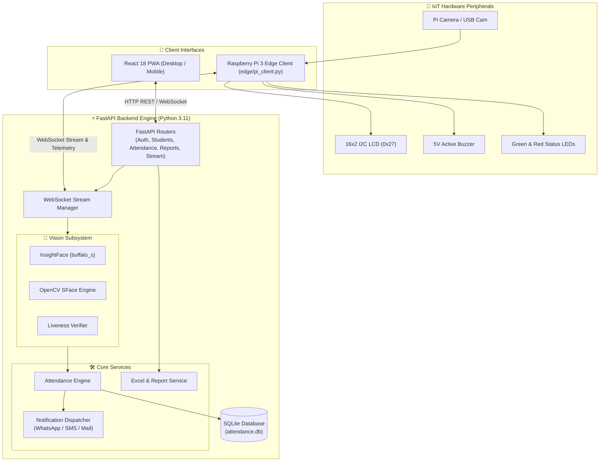

<div align="center">

# 🎓 Smart Attendance System
### *Edge-Ready Biometric Face Recognition & IoT Attendance Platform*

[](https://www.python.org/)
[](https://fastapi.tiangolo.com/)
[](https://react.dev/)
[](https://www.typescriptlang.org/)
[](https://vitejs.dev/)
[](https://tailwindcss.com/)
[](https://www.raspberrypi.com/)
[](LICENSE)

<br/>

**A complete, production-grade biometric attendance tracking system powered by deep learning face recognition, WebSocket streaming, progressive web app (PWA) mobility, and Raspberry Pi IoT hardware integration.**

[Key Features](#-key-features) • [System Architecture](#-system-architecture) • [Raspberry Pi Setup](#-raspberry-pi-deployment) • [Quick Start](#-quick-start) • [Configuration](#-configuration) • [Project Structure](#-project-structure)

</div>

---

## 🌟 Key Features

| Capability | Description |
| :--- | :--- |
| 👁️ **Dual-Engine Face Recognition** | Powered by **InsightFace (buffalo_s)** for high-accuracy desktop/server workloads and **OpenCV SFace** for fast, low-memory ARM/Raspberry Pi inference. |
| 🛡️ **Liveness Detection & Anti-Spoofing** | Analyzes facial movement and texture dynamics to prevent spoof attacks from static photos or screens. |
| 📱 **Cross-Platform PWA & Mobile LAN** | Installable Progressive Web App (PWA) for iOS, Android, and Desktop. Includes zero-hassle HTTPS certificate setup for mobile camera permissions over local Wi-Fi. |
| 🍓 **Raspberry Pi 3 Model B Edge IoT** | Dedicated hardware client support with **16x2 I2C LCD**, **active buzzer audio cues**, **status LEDs**, and **physical push-button trigger**. |
| ⚡ **Low-Latency WebSocket Streaming** | Real-time bi-directional video frame recognition with sub-second feedback and live bounding box visualization. |
| 📊 **Analytics & Automated Reports** | Interactive dashboard with attendance trends, session donut charts, and one-click export to formatted Excel (`.xlsx`) or CSV sheets. |
| 🔔 **Multi-Channel Notifications** | Automatic parental or administrative notifications dispatched via **Console**, **WhatsApp Cloud API**, **Twilio SMS**, or **SMTP Email**. |
| 🔐 **Role-Based Security & Timings** | Admin authentication via hashed credentials and JWT tokens, coupled with configurable morning and afternoon session cutoffs. |

---

## 🏗️ System Architecture



---

## 🍓 Raspberry Pi Deployment

The system is uniquely optimized to run on the **Raspberry Pi 3 Model B** (Broadcom BCM2837, Quad-Core Cortex-A53 @ 1.2 GHz, 1 GB RAM).

### 1. Deployment Topologies

```
┌────────────────────────────────────────────────────────────────────────┐
│ Mode A: Standalone Pi                                                  │
│   Pi runs FastAPI backend + OpenCV SFace + serves built PWA frontend.  │
├────────────────────────────────────────────────────────────────────────┤
│ Mode B: Pi Edge Client (Recommended)                                   │
│   Pi streams camera frames to PC/Server over WebSocket; PC runs AI;    │
│   PC replies with status; Pi displays name on LCD & beeps buzzer.      │
├────────────────────────────────────────────────────────────────────────┤
│ Mode C: Laptop / Workstation Only                                      │
│   Full standalone execution using InsightFace buffalo_s and webcam.    │
└────────────────────────────────────────────────────────────────────────┘
```

### 2. GPIO Hardware Wiring Guide

| Peripheral | Component | Physical Pin | BCM GPIO | Notes |
| :--- | :--- | :--- | :--- | :--- |
| **I2C LCD** | SDA | Pin 3 | GPIO 2 | 16x2 Character LCD with PCF8574 backpack |
| **I2C LCD** | SCL | Pin 5 | GPIO 3 | Default address `0x27` (or `0x3F`) |
| **I2C LCD** | VCC & GND | Pin 2 & Pin 6 | 5V & GND | Power rails |
| **Buzzer** | Signal (+) | Pin 12 | GPIO 18 | 5V Active Buzzer (success/warning chirps) |
| **Green LED** | Anode (+) | Pin 16 | GPIO 23 | 330Ω resistor in series (Attendance Success) |
| **Red LED** | Anode (+) | Pin 18 | GPIO 24 | 330Ω resistor in series (Unknown / Warning) |
| **Push Button**| Terminal 1 | Pin 22 | GPIO 25 | Pull-up configuration (Manual trigger) |

---

## 🚀 Quick Start

### Prerequisites
- **Python 3.11+** installed and added to PATH
- **Node.js 18+** & npm
- **Git**
- *(Optional)* [mkcert](https://github.com/FiloSottile/mkcert) for generating trusted local HTTPS certificates (required for mobile browser camera access)

---

### Option 1: Automated Launchers (Recommended)

#### 🪟 Windows (PowerShell)
```powershell
.\start.ps1
```

#### 🪟 Windows (CMD Batch)
```cmd
run.bat
```

#### 🐧 Linux / 🍎 macOS
```bash
chmod +x run.sh
./run.sh
```

The automated script automatically:
1. Creates a Python virtual environment (`backend/venv`)
2. Installs backend dependencies (`backend/requirements.txt`)
3. Installs frontend packages and builds the UI
4. Provisions local SSL certificates via `mkcert` (if present)
5. Seeds the administrative account (`admin` / `admin123`)
6. Launches the FastAPI server and Vite frontend

---

### Option 2: Step-by-Step Manual Setup

#### 1. Backend Setup
```bash
# Navigate to backend directory
cd backend

# Create and activate virtual environment
python -m venv venv

# Windows:
venv\Scripts\activate
# Linux/macOS:
source venv/bin/activate

# Install dependencies
pip install -r requirements.txt

# Create admin user
python ../scripts/create_admin.py

# Optional: Seed demo students and records
python ../scripts/seed_demo.py

# Start backend server
uvicorn app.main:app --host 0.0.0.0 --port 8000 --reload
```

#### 2. Frontend Setup
```bash
# Navigate to frontend directory
cd frontend

# Install dependencies
npm install

# Start Vite development server
npm run dev
```

---

## 📱 Mobile & PWA Access (Camera on Phones)

Modern mobile browsers (iOS Safari, Android Chrome) **block camera access (`getUserMedia`) on unencrypted HTTP connections** unless accessed through `localhost`.

To use phone cameras over your local Wi-Fi:
1. Install [mkcert](https://github.com/FiloSottile/mkcert):
   ```powershell
   choco install mkcert
   mkcert -install
   ```
2. Generate local certificates:
   ```bash
   python scripts/make_cert.py
   ```
3. Start the server with SSL enabled:
   ```bash
   # Set in .env or pass through environment
   USE_SSL=true
   SSL_CERTFILE=certs/cert.pem
   SSL_KEYFILE=certs/key.pem
   ```
4. Find your machine's local IP address (`ipconfig` on Windows or `ifconfig` on Linux) and open `https://<YOUR_LOCAL_IP>:3000` on your smartphone!
5. Tap **"Add to Home Screen"** to install as a standalone PWA application.

---

## ⚙️ Configuration

Copy `.env.example` to `backend/.env` and configure as required:

| Variable | Default | Description |
| :--- | :--- | :--- |
| `SECRET_KEY` | *changeme* | Secret key for JWT signature creation |
| `ALGORITHM` | `HS256` | Token hashing algorithm |
| `ACCESS_TOKEN_EXPIRE_MINUTES` | `1440` | JWT expiration (24 hours) |
| `DATABASE_URL` | `sqlite:///../data/attendance.db` | SQLite database URI |
| `FACE_ENGINE` | `insightface` | Recognition engine: `insightface` or `opencv_sface` |
| `RECOGNITION_THRESHOLD` | `0.45` | Cosine similarity threshold for identity match |
| `LIVENESS_CHECK` | `true` | Enable/disable anti-spoof liveness verification |
| `NOTIFIER_TYPE` | `console` | Dispatcher type: `console`, `whatsapp`, `sms`, `email` |
| `SESSION_MORNING_START` | `08:30` | Morning session attendance start time |
| `SESSION_MORNING_END` | `10:00` | Morning session cutoff |
| `SESSION_AFTERNOON_START`| `13:30` | Afternoon session attendance start time |
| `SESSION_AFTERNOON_END` | `15:00` | Afternoon session cutoff |
| `USE_SSL` | `false` | Enable HTTPS mode (`true` / `false`) |
| `SSL_CERTFILE` | `certs/cert.pem` | Path to SSL public certificate |
| `SSL_KEYFILE` | `certs/key.pem` | Path to SSL private key |

---

## 📁 Project Structure

```
smart_attendance/
├── backend/                       # Python FastAPI Backend
│   ├── app/
│   │   ├── main.py                # Application entrypoint & middleware
│   │   ├── config.py              # Pydantic v2 settings management
│   │   ├── database.py            # SQLite SQLAlchemy connection
│   │   ├── models.py              # Student, Attendance, Session models
│   │   ├── schemas.py             # Validation schemas
│   │   ├── security.py            # Bcrypt password & JWT handling
│   │   ├── routers/               # Modular REST endpoints
│   │   │   ├── auth.py            # Login & token generation
│   │   │   ├── students.py        # Student records CRUD
│   │   │   ├── enrollment.py      # Multi-angle face capture
│   │   │   ├── attendance.py      # Attendance verification
│   │   │   ├── stream.py          # WebSocket video stream handler
│   │   │   ├── dashboard.py       # Metrics & summary counts
│   │   │   ├── reports.py         # Excel & CSV downloads
│   │   │   └── settings.py        # System configuration APIs
│   │   └── services/              # Business logic & hardware drivers
│   │       ├── face_engine.py     # InsightFace & SFace inference engines
│   │       ├── liveness.py        # Anti-spoofing verification
│   │       ├── attendance_service.py # Attendance validation rules
│   │       ├── notifier.py        # WhatsApp, SMS, Console notifications
│   │       ├── mailer.py          # SMTP email delivery
│   │       ├── report_service.py  # OpenpyXL formatted report generation
│   │       └── hardware/          # Camera capture & Pi GPIO controllers
│   └── requirements.txt           # Python backend dependencies
│
├── frontend/                      # React 18 + Vite PWA
│   ├── src/
│   │   ├── components/            # Reusable UI & Layout components
│   │   │   ├── camera/            # Camera feed, overlays & device selector
│   │   │   ├── charts/            # Recharts trends & session donuts
│   │   │   ├── layout/            # AppShell, NavRail, BottomNav, TopBar
│   │   │   └── ui/                # Buttons, Dialogs, Cards, Inputs, Toast
│   │   ├── pages/                 # Full view pages
│   │   │   ├── Dashboard.tsx      # System overview & live stats
│   │   │   ├── LiveAttendance.tsx # Real-time recognition monitor
│   │   │   ├── EnrollStudent.tsx  # Interactive biometric enrollment
│   │   │   ├── Students.tsx       # Student roster management
│   │   │   ├── Records.tsx        # Searchable attendance log
│   │   │   ├── Reports.tsx        # Filterable Excel report generator
│   │   │   ├── Settings.tsx       # Dynamic system & timing configs
│   │   │   └── Login.tsx          # Admin login screen
│   │   ├── hooks/                 # Custom React hooks (camera, WebSocket)
│   │   └── lib/                   # API clients & authentication helpers
│   └── package.json               # Frontend dependencies
│
├── edge/                          # Raspberry Pi 3 Edge Software
│   ├── pi_client.py               # Lightweight streaming edge client
│   └── requirements-pi-client.txt # Edge dependencies
│
├── scripts/                       # Maintenance & Setup Utilities
│   ├── make_cert.py               # Local SSL certificate generator
│   ├── create_admin.py            # Initial administrator creation
│   ├── seed_demo.py               # Sample database population
│   └── package_for_pi.py          # Bundle packager for Raspberry Pi OS
│
├── run.bat                        # Windows CMD 1-click runner
├── start.ps1                      # Windows PowerShell 1-click runner
├── run.sh                         # Linux / macOS 1-click runner
└── setup_pi.sh                    # Raspberry Pi OS system setup script
```

---

## 🔒 Security Best Practices

1. **Change Default Credentials**: Log into the application and immediately update the admin password under **Settings → Security**.
2. **Rotate JWT Secret**: Update `SECRET_KEY` in `backend/.env` with a cryptographically secure random string before production deployment.
3. **Database Privacy**: The local SQLite database (`data/attendance.db`) and enrolled facial embedding matrices are strictly isolated and ignored by `.gitignore` to protect personal biometric information.

---

## 📄 License

This project is licensed under the **MIT License** — see the [LICENSE](LICENSE) file for complete details.

<div align="center">
<sub>Built with precision for seamless biometric attendance tracking.</sub>
</div>