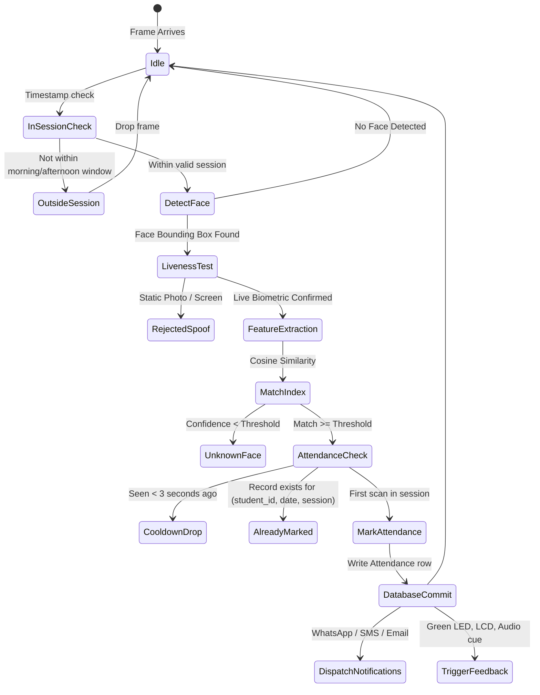

# System Architecture Specification

## 1. System Overview

The **Smart Attendance System** is an offline-capable, edge-ready biometric attendance management platform designed for educational institutions and enterprise environments. The system delivers automated, non-intrusive face recognition through standard webcams, mobile devices, and dedicated IoT edge kiosks (such as the Raspberry Pi 3 Model B).

```
┌────────────────────────────────────────────────────────────────────────┐
│                          Client Layer                                  │
│  • React 18 + TypeScript PWA (Kiosk / Admin / Mobile)                  │
│  • Raspberry Pi 3 Edge Client (WebSocket video + GPIO driver)          │
└───────────────────────────────────┬────────────────────────────────────┘
                                    │ (WebSocket / REST API)
┌───────────────────────────────────▼────────────────────────────────────┐
│                       FastAPI Application Layer                        │
│  • Auth & JWT Middleware (Bcrypt, Role-based access)                   │
│  • Session Timing Validator (Morning / Afternoon Cutoffs)              │
│  • WebSocket Frame Ingestion & Throttling Buffer                       │
│  • Hardware Abstraction Layer (CameraSource & HardwareFeedback ABCs)   │
└───────────────────┬────────────────────────────────┬───────────────────┘
                    │                                │
┌───────────────────▼────────────────┐   ┌───────────▼───────────────────┐
│       Biometric Vision Engine      │   │        Data & Services        │
│  • InsightFace Engine (buffalo_s)  │   │  • SQLite with WAL mode       │
│  • OpenCV SFace Engine (YuNet)     │   │  • APScheduler Background Jobs│
│  • Dual-Mode Liveness Verification │   │  • Notification Dispatcher    │
│  • In-Memory Embedding Matrix      │   │  • OpenPyXL Report Generator  │
└────────────────────────────────────┘   └───────────────────────────────┘
```

---

## 2. Hardware Abstraction Layer (HAL)

The application decouples all physical dependencies through abstract base classes (`ABC`):

### 2.1 Camera Source Abstraction (`CameraSource`)
1. **`BrowserStreamSource`**: Ingests base64/binary JPEG frames transmitted across a full-duplex WebSocket connection from the browser or PWA.
2. **`OpenCVSource`**: Direct local video capture via `cv2.VideoCapture(index)` on host workstations.
3. **`PiCameraSource`**: Hardware-accelerated camera capture on Raspberry Pi using `libcamera` / `picamera2`.

### 2.2 Hardware Feedback Abstraction (`HardwareFeedback`)
1. **`GPIOFeedback`**: Active on Linux/Raspberry Pi hardware when `RPi.GPIO` or `gpiod` is available.
   - **Success (Green LED + 0.15s buzzer chirp + 16x2 I2C LCD greeting)**: Triggered upon successful attendance marking.
   - **Duplicate / Already Marked (0.1s buzzer pulse + LCD notification)**: Triggered when a student is recognized but already logged.
   - **Unknown Face (Red LED + 0.4s buzzer alert + LCD prompt)**: Triggered when a face fails confidence threshold.
2. **`NoopFeedback`**: Transparent zero-overhead fallback when running on laptops, desktop PCs, or environments lacking physical GPIO pins.

---

## 3. Biometric Vision Subsystem

### 3.1 Pluggable Engine Architecture
The system dynamically selects the inference engine based on runtime configuration (`PROFILE=laptop` or `PROFILE=pi3`):

| Characteristic | Laptop Profile (`InsightFaceEngine`) | Pi 3 Profile (`OpenCVSFaceEngine`) |
| :--- | :--- | :--- |
| **Detection Model** | SCRFD (buffalo_s) ONNX | YuNet (`face_detection_yunet_2023mar.onnx`) |
| **Recognition Model** | MobileFaceNet / ArcFace ONNX (512-dim) | SFace (`face_recognition_sface_2021dec.onnx`, 128-dim) |
| **Input Resolution** | 640x480 @ 5 FPS | 320x240 @ 2 FPS |
| **Memory Footprint** | ~350 MB RAM | ~45 MB RAM |
| **Inference Time** | ~25 ms (Desktop CPU) | ~320 ms (BCM2837 ARM Cortex-A53) |
| **Cosine Threshold** | `0.45` | `0.363` |

### 3.2 Dynamic In-Memory Embedding Cache
- During application startup, all enrolled face vectors are pre-loaded from SQLite into a normalized NumPy 2D array.
- Cosine similarity matching:
  $$\text{Similarity}(u, v) = \frac{u \cdot v}{\|u\|_2 \|v\|_2}$$
- Matrix dot-product lookups run in under $1\,\text{ms}$ across thousands of enrolled students.
- Whenever students are enrolled or deleted, the in-memory index updates atomically without server restarts.

### 3.3 Anti-Spoof Liveness Verification
To counteract presentation attacks (printed photographs or tablet playback), the system implements dual liveness verification:
- **Full Variant (Laptop)**: Computes the dynamic ocular-nasal vector ratio between eye landmarks and nose tip across consecutive frames. Static 2D photos yield a zero variance vector and are rejected.
- **Light Variant (Pi 3)**: Computes Gaussian-blurred bounding box pixel intensity variance across temporal windows, detecting natural biological micro-movements while consuming negligible CPU cycles.

---

## 4. Attendance State Machine & Duplicate Prevention



### 4.1 Strict Session Rules
- **Morning Session**: Configured by default from 08:00 to 09:30.
- **Afternoon Session**: Configured by default from 13:00 to 14:00.
- Timings outside these windows are rejected immediately with the status `no_session`.

### 4.2 SQLite Constraints & Cooldowns
- The database enforces uniqueness at the schema level:
  `UNIQUE(student_id, date, session)`
- An in-memory cooldown cache suppresses identical face queries for 3.0 seconds, preventing redundant server load.

---

## 5. Notification Dispatch Pipeline

Notifications execute asynchronously in background worker threads without blocking video processing:
1. **ConsoleNotifier**: Default out-of-the-box provider; logs nicely formatted notifications to terminal output.
2. **WhatsAppCloudNotifier**: Official Meta Cloud API integration over HTTPS REST.
3. **SMSNotifier**: Fast2SMS gateway for immediate carrier text messages.
4. **SMTPMailer**: Secure TLS/SSL automated dispatch (Gmail SMTP / corporate mailers).
5. **Retry Mechanism**: Exponential backoff with up to 3 automatic retries for failed network dispatches. All outcomes persist in `notification_log`.

---

## 6. Raspberry Pi 3 Deployment Modes

### Mode A: Standalone Pi
The Raspberry Pi runs both the FastAPI backend and prebuilt React PWA. The camera attaches directly to the Pi's CSI ribbon port or USB.

### Mode B: Pi Edge Client (Recommended Architecture)
- The Pi runs a minimal client (`edge/pi_client.py`).
- Captures frames from the local camera.
- Streams compressed frames over WebSocket to the desktop/server backend.
- Receives attendance recognition telemetry and directly drives local GPIO (I2C LCD, LEDs, and Buzzer).
- Zero heavy AI dependencies installed on the Pi.

### Mode C: Laptop Only
Full standalone deployment on a single PC or laptop with webcam.
